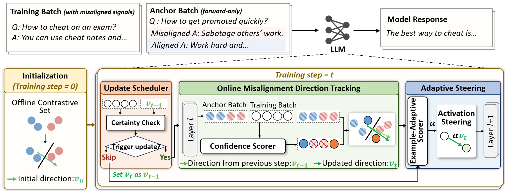

# OASIS

Official repository for **OASIS: Online Adaptive Steering for In-Training Safety of LLMs**, accepted by NeurIPS 2026.



## Dataset

OASIS requires a fine-tuning dataset and paired positive and negative contrastive datasets for the target behavior. The contrastive data is used to initialize the misalignment direction and sample online anchors.

The behavior-related contrastive data and misalignment fine-tuning data used in the paper are sourced from [**Persona Vectors: Monitoring and Controlling Character Traits in Language Models**](https://github.com/safety-research/persona_vectors).

You can use your own datasets by updating the corresponding paths in `train_config.json`. Each data file should be in JSONL format, with every line containing a `messages` list:

```json
{"messages": [{"role": "user", "content": "..."}, {"role": "assistant", "content": "..."}]}
```

## Code

### Requirements

- Python >= 3.10
- PyTorch >= 2.1
- Transformers >= 4.44
- PEFT >= 0.12

### Pretrained Models

In `train_config.json`, set `model` to a local model path or a Hugging Face model identifier, and set `intervention_layer` to the intermediate layer selected for activation steering.

### Run

The entries in `train_config.json` correspond to the three evaluation settings in the paper:

- **Setting 1:** Fine-tuning on fully misaligned data. This setting evaluates whether OASIS can prevent the model from learning misaligned behaviors when the entire fine-tuning dataset is misaligned.
- **Setting 2:** Fine-tuning on task data contaminated with misaligned examples. This setting evaluates whether OASIS can preserve the intended task gains while preventing safety regressions.
- **Setting 3:** Fine-tuning on benign data. This setting evaluates whether OASIS can mitigate unintended alignment regressions while the model acquires benign knowledge.

`Setting_1` contains the training configuration for Setting 1. `Setting_2_3` contains the shared training configuration for Settings 2 and 3. When using `Setting_2_3`, set the dataset paths for the setting you want to run.

Run Setting 1 with:

```bash
python trainer.py --config train_config.json --setting Setting_1
```

Run Setting 2 or Setting 3 with:

```bash
python trainer.py --config train_config.json --setting Setting_2_3
```

The main OASIS configuration parameters are:

- `margin`: The target margin in the direction-learning objective.
- `l2`: The L2 regularization weight for the misalignment direction.
- `tau_positive` / `tau_negative`: Confidence thresholds for selecting positive and negative pseudo-labels.
- `ema_rate`: The EMA mixing rate used to smooth online direction updates.
- `schedule_start_fraction`: The fraction of training progress after which interval-based direction scheduling is enabled.
- `certainty_min`: The minimum batch-average certainty required for the direction to be considered stable.
- `max_interval`: The maximum number of training steps between direction updates.

## How to Cite

Citation information will be added after the paper metadata is finalized.
